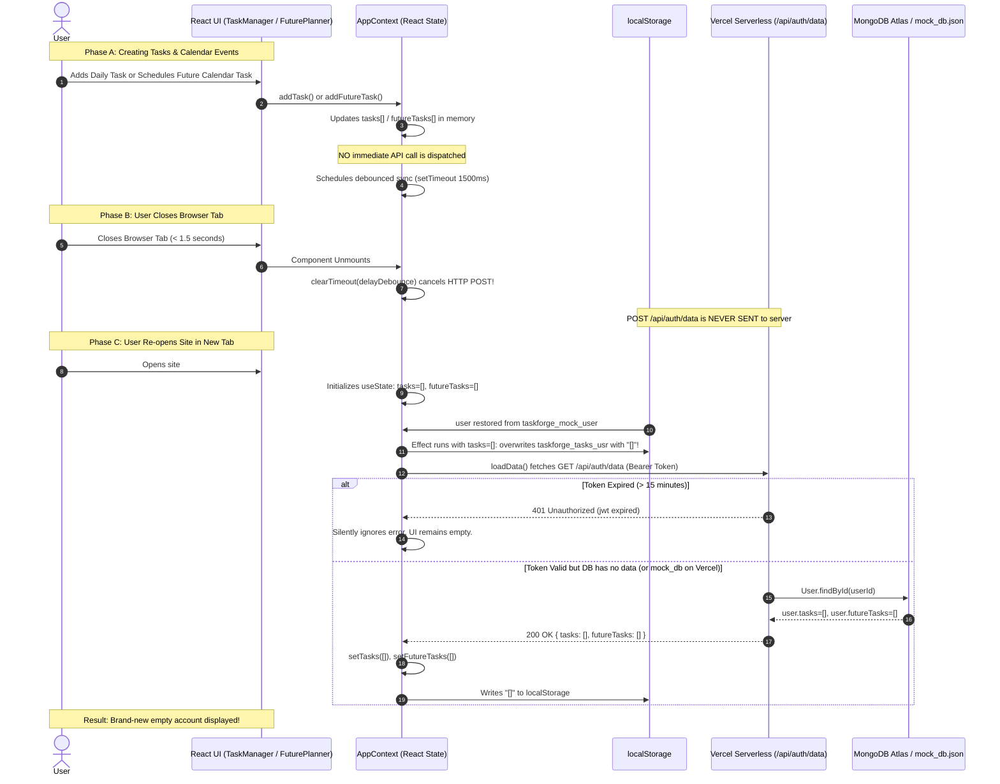

# PERSISTENCE BUG AUDIT REPORT: TaskForge

**Project**: TaskForge Web Application  
**Target Environment**: React Frontend (Vite), Node/Express Backend, Vercel Serverless  
**Audit Type**: Root Cause Diagnosis & Codebase Audit (No code modified)  
**Date of Audit**: October 17, 2026  

---

## 1. Summary

The primary reason user data disappears after closing the browser tab is a combination of client-side sync race conditions, unhandled serverless file-persistence failures, and session token expiration:

1. **State Overwrite & Debounce Cancellation**: When a user creates tasks or future calendar items, no immediate API request is sent; the frontend schedules a 1.5-second debounced sync that is abruptly cancelled when the tab is closed. When the app reopens, the React state initializes as empty (`[]`) and immediately overwrites `localStorage` before the asynchronous database fetch can complete, while the database fetch itself returns empty arrays and wipes the UI.
2. **Database & Environment Mismatch**: The repository does **not** use PostgreSQL or Prisma at runtime—it uses Mongoose (MongoDB) with a fallback to a local JSON file (`mock_db.json`). While `.env` contains an unused `DATABASE_URL="prisma+postgres://..."`, the server only connects to `MONGO_URI`. In production on Vercel serverless, missing MongoDB credentials cause the server to fall back to `mock_db.json`, which fails silently because the Vercel serverless root filesystem is read-only and serverless containers are ephemeral.
3. **Session Expiry & Token Deletion**: The JWT access token expires in 15 minutes with no refresh mechanism, causing all subsequent data requests to fail with `401 Unauthorized`, while an unload listener in `App.jsx` actively deletes the token on tab close if `rememberMe` is false.

---

## 2. Evidence

### Cause 1: Task and Calendar Creation Stored Only in React State with Cancelled Debounced Sync
- **File**: [`src/context/AppContext.jsx`](file:///c:/Users/about/OneDrive/Desktop/dailyTask/src/context/AppContext.jsx)
- **Lines**: 867–883 (`addTask`), 935–948 (`addFutureTask`), 302–333 (`useEffect` sync)
- **Explanation**: Adding a daily task or scheduling a future calendar event only pushes items into local React state (`setTasks`, `setFutureTasks`). No direct API call (`POST /api/tasks` or `POST /api/events`) exists. Persistence to the backend depends completely on a 1500ms `setTimeout`. If the user closes the browser tab within 1.5 seconds of adding a task, the cleanup function `clearTimeout(delayDebounce)` runs, and the HTTP request is **never sent**.

```javascript
// src/context/AppContext.jsx: lines 867-883
const addTask = (title, category = 'Study', priority = 'medium', dueTime = '', estimatedTime = 0, notes = '') => {
  const newTask = {
    id: 'task_' + Math.random().toString(36).substr(2, 9),
    title,
    completed: false,
    // ...
    createdAt: Date.now()
  };
  setTasks(prev => [newTask, ...prev]); // <-- Only local React state! No API call.
};

// src/context/AppContext.jsx: lines 313-333
const delayDebounce = setTimeout(async () => {
  try {
    const token = localStorage.getItem('taskforge_token');
    if (token) {
      await fetch(`${API_BASE}/api/auth/data`, {
        method: 'POST',
        headers: { 
          'Content-Type': 'application/json',
          'Authorization': `Bearer ${token}`
        },
        body: JSON.stringify({ tasks, futureTasks, weeklyObjectives, monthlyGoals, history })
      });
    }
  } catch (err) {
    console.warn('[Sync] Failed to sync data to cloud database (offline)', err);
  }
}, 1500);

return () => clearTimeout(delayDebounce); // <-- CANCELS server save on tab close / unmount!
```

---

### Cause 2: Mount-Time Empty State Overwrite (`localStorage` Wiped on Initial Render)
- **File**: [`src/context/AppContext.jsx`](file:///c:/Users/about/OneDrive/Desktop/dailyTask/src/context/AppContext.jsx)
- **Lines**: 142–146 (State initialization), 302–312 (Sync effect execution on mount)
- **Explanation**: `tasks`, `futureTasks`, and `history` are initialized to empty arrays `[]` and `{}`. Because the auto-sync effect (line 302) has dependencies `[tasks, futureTasks, weeklyObjectives, monthlyGoals, history, user]`, it runs on initial mount when `user` is restored from `taskforge_mock_user`. At that moment, `tasks` and `futureTasks` are `[]`. The effect executes synchronously:
  ```javascript
  localStorage.setItem(`taskforge_tasks_${userId}`, JSON.stringify(tasks)); // writes "[]"
  localStorage.setItem(`taskforge_future_${userId}`, JSON.stringify(futureTasks)); // writes "[]"
  ```
  This immediately blows away whatever was stored in `localStorage` from earlier sessions before the asynchronous `loadData()` function can populate state.

---

### Cause 3: Database & Architectural Mismatch (PostgreSQL/Prisma vs MongoDB/Mongoose)
- **Files**: [`.env`](file:///c:/Users/about/OneDrive/Desktop/dailyTask/.env) (Line 31), [`api/config/db.js`](file:///c:/Users/about/OneDrive/Desktop/dailyTask/api/config/db.js) (Lines 3–17), [`package.json`](file:///c:/Users/about/OneDrive/Desktop/dailyTask/package.json) (Lines 13–30)
- **Explanation**: The user expected a PostgreSQL + Prisma architecture. `.env` contains:
  ```env
  DATABASE_URL="prisma+postgres://localhost:51213/?api_key=..."
  ```
  However, `package.json` contains **zero** Prisma packages (no `@prisma/client`, no `prisma`). The backend in `api/config/db.js` never references `DATABASE_URL`—it exclusively reads `process.env.MONGO_URI`:
  ```javascript
  // api/config/db.js: lines 3-10
  export const connectDB = async () => {
    try {
      const conn = await mongoose.connect(process.env.MONGO_URI || 'mongodb://127.0.0.1:27017/taskforge', {
        serverSelectionTimeoutMS: 8000
      });
      global.isMockDB = false;
    } catch (error) {
      // Falls back to mock_db.json
      global.isMockDB = true;
    }
  };
  ```
  If Vercel environment variables are configured with `DATABASE_URL` instead of `MONGO_URI`, Mongoose cannot connect.

---

### Cause 4: Backend Fallback to Local `mock_db.json` on Vercel Serverless
- **Files**: [`api/services/dbService.js`](file:///c:/Users/about/OneDrive/Desktop/dailyTask/api/services/dbService.js) (Lines 9, 51–71, 99–125), [`.gitignore`](file:///c:/Users/about/OneDrive/Desktop/dailyTask/.gitignore) (Line 21)
- **Explanation**: When MongoDB connection fails (or times out), `global.isMockDB` is set to `true`. All read/write operations go to `api/mock_db.json`.
  1. On Vercel serverless lambdas, the root file system is **read-only** (except `/tmp`). Any call to `fs.writeFileSync(MOCK_DB_PATH, ...)` throws `EROFS: read-only file system`. In `writeMockDB` (line 69), the error is caught and swallowed by `console.error`.
  2. Serverless function instances are stateless and ephemeral; even if writes succeeded in memory or `/tmp`, container recycling erases all changes.
  3. `.gitignore` line 21 excludes `api/mock_db.json` from git commits, meaning the file does not exist on remote deployment unless generated at runtime.
  4. In `dbService.createUser` (lines 99–125), `mock_db.json` users are created **without** `tasks`, `futureTasks`, `weeklyObjectives`, `monthlyGoals`, or `history` fields.

---

### Cause 5: Missing `await` on Database Connection in Serverless Entrypoint
- **File**: [`api/index.js`](file:///c:/Users/about/OneDrive/Desktop/dailyTask/api/index.js)
- **Line**: 14
- **Explanation**: 
  ```javascript
  // api/index.js: line 14
  connectDB();
  ```
  `connectDB()` is an asynchronous function called at the module top level without `await`. In a serverless environment (Vercel), requests execute immediately before `connectDB()` resolves. When the first requests arrive, `global.isMockDB` is `undefined` or connection is incomplete, causing unhandled database state or immediate fallback to mock DB.

---

### Cause 6: 15-Minute JWT Expiry with No Token Refresh or Validation on App Load
- **Files**: [`api/controllers/authController.js`](file:///c:/Users/about/OneDrive/Desktop/dailyTask/api/controllers/authController.js) (Line 6), [`api/middleware/auth.js`](file:///c:/Users/about/OneDrive/Desktop/dailyTask/api/middleware/auth.js) (Lines 6–25), [`src/context/AppContext.jsx`](file:///c:/Users/about/OneDrive/Desktop/dailyTask/src/context/AppContext.jsx) (Lines 97–105, 170–172, 246–295)
- **Explanation**:
  1. The access token is created with a 15-minute lifespan:
     ```javascript
     const ACCESS_EXPIRY = process.env.JWT_ACCESS_EXPIRY || '15m';
     ```
  2. On frontend load, `isAuthenticated` is initialized based solely on whether `taskforge_mock_user` exists in `localStorage`:
     ```javascript
     const [isAuthenticated, setIsAuthenticated] = useState(() => {
       return localStorage.getItem('taskforge_mock_user') !== null;
     });
     ```
  3. No token validation endpoint (`/api/auth/me`) is called. When 15 minutes elapse (e.g., closing the tab and reopening later), `taskforge_token` is expired.
  4. When `loadData()` calls `GET /api/auth/data` with `Authorization: Bearer ${token}`, `requireAuth` throws `TokenExpiredError` and returns `401 Invalid or expired token`.
  5. `loadData()` silently fails when `response.ok` is false, and `refreshSession()` in `AppContext.jsx` is an empty no-op returning `true`:
     ```javascript
     const refreshSession = async () => {
       return true;
     };
     ```
  6. As a result, no data is fetched from the server, and subsequent saves fail with 401.

---

### Cause 7: `beforeunload` Session Purge When `rememberMe === 'false'`
- **File**: [`src/App.jsx`](file:///c:/Users/about/OneDrive/Desktop/dailyTask/src/App.jsx) (Lines 31–45), [`src/components/Auth.jsx`](file:///c:/Users/about/OneDrive/Desktop/dailyTask/src/components/Auth.jsx) (Line 62)
- **Explanation**: `App.jsx` listens to `beforeunload`:
  ```javascript
  // src/App.jsx: lines 31-40
  useEffect(() => {
    const handleUnload = () => {
      const rememberMe = localStorage.getItem('taskforge_remember_me');
      if (rememberMe === 'false') {
        localStorage.removeItem('taskforge_token');
        localStorage.removeItem('taskforge_active_user');
        localStorage.removeItem('taskforge_refresh_token');
      }
    };
    window.addEventListener('beforeunload', handleUnload);
    return () => window.removeEventListener('beforeunload', handleUnload);
  }, []);
  ```
  In `Auth.jsx`, `rememberMe` defaults to `false`. If the user logs in without checking "Remember Me", or if `taskforge_remember_me` is set to `'false'`, closing the browser tab permanently deletes `taskforge_token`, breaking the session on the next tab open.

---

### Cause 8: Google OAuth Client-Side Fallback Generates New User ID on Every Login
- **File**: [`src/context/AppContext.jsx`](file:///c:/Users/about/OneDrive/Desktop/dailyTask/src/context/AppContext.jsx)
- **Lines**: 607–624
- **Explanation**: If Google Identity Services SDK fails to initialize or encounters a network issue, the catch block executes:
  ```javascript
  const mockGoogleId = 'g_' + Math.random().toString(36).substr(2, 9);
  const mockUser = {
    id: mockGoogleId,
    _id: mockGoogleId,
    // ...
  };
  setUser(mockUser);
  localStorage.setItem('taskforge_mock_user', JSON.stringify(mockUser));
  ```
  Because offline local cache keys are scoped by user ID (`taskforge_tasks_${userId}`), generating a new random `mockGoogleId` every login causes the app to look under a completely different key, making all existing tasks disappear.

---

### Cause 9: Daily Rollover Resetting Tasks on Date Change
- **File**: [`src/context/AppContext.jsx`](file:///c:/Users/about/OneDrive/Desktop/dailyTask/src/context/AppContext.jsx)
- **Lines**: 218–233, 259–271
- **Explanation**:
  ```javascript
  let isNewDay = false;
  if (lastSavedDate) {
    isNewDay = lastSavedDate !== currentSessionDate;
  }
  if (isNewDay) {
    initialTasks = []; // Clears daily tasks for new day
  }
  ```
  If a user logs in, creates daily tasks, closes the tab, and re-opens the app on the next calendar day (or past 4:00 AM), `isNewDay` evaluates to `true`. The active daily task list is intentionally reset to `[]`. However, because `history` and `futureTasks` are also lost due to Causes 1, 2, and 4, the entire account appears blank.

---

## 3. Flow Trace: Step-by-Step Data Loss



---

## 4. Ruled Out Causes

| Possible Cause | Verdict | Evidence / Justification |
| :--- | :--- | :--- |
| **Prisma writes not committing, or userId not attached to records** | **RULED OUT** | Prisma and PostgreSQL are **not present** in the codebase. There is no `schema.prisma`, no `@prisma/client` in `package.json`, and no Prisma queries in the controllers. Database operations use Mongoose or `mock_db.json`. |
| **Google OAuth backend creating duplicate users** | **RULED OUT (Backend)** | In `api/controllers/authController.js` (lines 308–320), `googleLogin` looks up existing users via `dbService.findUserByEmail(email)`. If found, it links the provider (`googleId: sub`) to the existing user ID. It only creates a new user if the email does not exist. |
| **CORS / cookie configuration issues (`withCredentials`, `sameSite`, `secure`)** | **RULED OUT** | The application does not use cookies for authentication or data endpoints. All authorization relies on the `Authorization: Bearer <token>` header (`api/middleware/auth.js` line 7). Furthermore, `vercel.json` rewrites `/api/(.*)` to the same domain, eliminating cross-origin CORS blocks in production. |
| **JWT stored only in memory** | **RULED OUT** | The JWT token is saved to `localStorage` under `'taskforge_token'` (`src/context/AppContext.jsx` line 470, 507, 557, 592). The issue is not in-memory storage, but lack of token validation on mount, a 15-minute expiration without a refresh mechanism, and unprompted deletion on `beforeunload`. |

---

## 5. Recommended Fix (Prioritized Code Diffs)

> [!IMPORTANT]
> The following code diffs are recommended for implementation. They have **NOT** been applied to the workspace.

### Priority 1: Prevent Initial Mount State Overwrite & Add Loading Guard
**File**: `src/context/AppContext.jsx`  
Add an `isDataLoaded` flag. Do not allow the sync effect to write empty arrays to `localStorage` or dispatch a `POST /api/auth/data` until the initial data load has completed. Also initialize state directly from `localStorage` synchronously.

```diff
--- a/src/context/AppContext.jsx
+++ b/src/context/AppContext.jsx
@@ -141,5 +141,19 @@ export const AppProvider = ({ children }) => {
   // Core Application Data (scoped to user)
-  const [tasks, setTasks] = useState([]);
-  const [futureTasks, setFutureTasks] = useState([]);
-  const [weeklyObjectives, setWeeklyObjectives] = useState([]);
-  const [monthlyGoals, setMonthlyGoals] = useState([]);
-  const [history, setHistory] = useState({});
+  const currentUserId = user?._id || user?.id;
+  const [isDataLoaded, setIsDataLoaded] = useState(false);
+
+  const [tasks, setTasks] = useState(() => {
+    if (!currentUserId) return [];
+    const saved = localStorage.getItem(`taskforge_tasks_${currentUserId}`);
+    return saved ? JSON.parse(saved) : [];
+  });
+  const [futureTasks, setFutureTasks] = useState(() => {
+    if (!currentUserId) return [];
+    const saved = localStorage.getItem(`taskforge_future_${currentUserId}`);
+    return saved ? JSON.parse(saved) : [];
+  });
+  const [weeklyObjectives, setWeeklyObjectives] = useState(() => {
+    if (!currentUserId) return [];
+    const saved = localStorage.getItem(`taskforge_weekly_${currentUserId}`);
+    return saved ? JSON.parse(saved) : [];
+  });
+  const [monthlyGoals, setMonthlyGoals] = useState(() => {
+    if (!currentUserId) return [];
+    const saved = localStorage.getItem(`taskforge_monthly_${currentUserId}`);
+    return saved ? JSON.parse(saved) : [];
+  });
+  const [history, setHistory] = useState(() => {
+    if (!currentUserId) return {};
+    const saved = localStorage.getItem(`taskforge_history_${currentUserId}`);
+    return saved ? JSON.parse(saved) : {};
+  });

@@ -295,5 +309,6 @@ export const AppProvider = ({ children }) => {
         } catch (err) {
           console.warn('[Sync] Failed to fetch fresh data from cloud, using offline cache', err);
         } finally {
+          setIsDataLoaded(true);
         }
       }
     };
     loadData();
   }, [user?._id || user?.id]);

@@ -302,6 +317,6 @@ export const AppProvider = ({ children }) => {
   // Sync state to local storage instantly & debounce cloud database sync
   useEffect(() => {
-    if (!user) return;
+    if (!user || !isDataLoaded) return; // <-- GUARD: Do not overwrite storage during initial render
     const userId = user._id || user.id;

     // Save to local storage for offline-first resilience
```

---

### Priority 2: Immediate Save / Flush on Tab Close (`visibilitychange` & `keepalive`)
**File**: `src/context/AppContext.jsx`  
When the user closes the tab or switches tabs, instantly flush pending state to the server using `fetch` with `keepalive: true` so the request survives tab closure.

```diff
--- a/src/context/AppContext.jsx
+++ b/src/context/AppContext.jsx
@@ -330,6 +330,25 @@ export const AppProvider = ({ children }) => {
     return () => clearTimeout(delayDebounce);
   }, [tasks, futureTasks, weeklyObjectives, monthlyGoals, history, user]);

+  // Flush unsaved data on page visibility change or unload
+  useEffect(() => {
+    const flushSync = () => {
+      if (!user) return;
+      const token = localStorage.getItem('taskforge_token');
+      if (token) {
+        fetch(`${API_BASE}/api/auth/data`, {
+          method: 'POST',
+          headers: {
+            'Content-Type': 'application/json',
+            'Authorization': `Bearer ${token}`
+          },
+          body: JSON.stringify({ tasks, futureTasks, weeklyObjectives, monthlyGoals, history }),
+          keepalive: true // <-- Allows request to complete even if tab closes
+        }).catch(() => {});
+      }
+    };
+    window.addEventListener('visibilitychange', flushSync);
+    return () => window.removeEventListener('visibilitychange', flushSync);
+  }, [tasks, futureTasks, weeklyObjectives, monthlyGoals, history, user]);
```

---

### Priority 3: Resolve Database Configuration for Production (Vercel)
**File**: `api/config/db.js` and Vercel Dashboard  
Ensure `MONGO_URI` is used consistently, remove mock DB fallback in production, and properly await database connections in serverless middleware.

```diff
--- a/api/config/db.js
+++ b/api/config/db.js
@@ -1,17 +1,24 @@
 import mongoose from 'mongoose';

+let cachedConnection = null;
+
 export const connectDB = async () => {
+  if (cachedConnection && mongoose.connection.readyState === 1) {
+    return cachedConnection;
+  }
+
   try {
-    const conn = await mongoose.connect(process.env.MONGO_URI || 'mongodb://127.0.0.1:27017/taskforge', {
-      serverSelectionTimeoutMS: 8000 // Allow more time for MongoDB Atlas cloud connection
+    const mongoUri = process.env.MONGO_URI;
+    if (!mongoUri) {
+      throw new Error('MONGO_URI environment variable is missing.');
+    }
+    cachedConnection = await mongoose.connect(mongoUri, {
+      serverSelectionTimeoutMS: 8000,
+      bufferCommands: false
     });
-    console.log(`[MongoDB] Connected successfully to host: ${conn.connection.host}`);
     global.isMockDB = false;
+    return cachedConnection;
   } catch (error) {
-    console.warn(`\n======================================================`);
-    console.warn(`[MongoDB] Connection failed: ${error.message}`);
-    console.warn(`[MongoDB] Falling back to simulated JSON File Database (mock_db.json)`);
-    console.warn(`======================================================\n`);
-    global.isMockDB = true;
+    console.error(`[MongoDB] Connection error: ${error.message}`);
+    throw error;
   }
 };
```

In `api/index.js`, add a middleware to await the DB connection before handling API routes:

```diff
--- a/api/index.js
+++ b/api/index.js
@@ -13,4 +13,12 @@ dotenv.config();
 
-// Establish Database Connection
-connectDB();
+app.use(async (req, res, next) => {
+  try {
+    await connectDB();
+    next();
+  } catch (err) {
+    res.status(503).json({ message: 'Database connection unavailable' });
+  }
+});
```

---

### Priority 4: Fix Token Lifetime and Prevent Unwanted Session Purge
**Files**: `api/controllers/authController.js`, `src/App.jsx`

Extend access token expiration to 7 days (or implement refresh token rotation) and stop deleting session tokens on `beforeunload`:

```diff
--- a/api/controllers/authController.js
+++ b/api/controllers/authController.js
@@ -6,3 +6,3 @@ const ACCESS_SECRET = process.env.JWT_ACCESS_SECRET || 'taskforge_jwt_access_se
-const ACCESS_EXPIRY = process.env.JWT_ACCESS_EXPIRY || '15m';
+const ACCESS_EXPIRY = process.env.JWT_ACCESS_EXPIRY || '7d';
```

```diff
--- a/src/App.jsx
+++ b/src/App.jsx
@@ -31,15 +31,2 @@ function AppContent() {
-  // Handle remember me session cleanup on unload
-  useEffect(() => {
-    const handleUnload = () => {
-      const rememberMe = localStorage.getItem('taskforge_remember_me');
-      if (rememberMe === 'false') {
-        localStorage.removeItem('taskforge_token');
-        localStorage.removeItem('taskforge_active_user');
-        localStorage.removeItem('taskforge_refresh_token');
-      }
-    };
-    window.addEventListener('beforeunload', handleUnload);
-    return () => {
-      window.removeEventListener('beforeunload', handleUnload);
-    };
-  }, []);
```

---

## 6. How to Verify

Follow these exact steps to verify data persistence before and after applying the fix:

### 1. Browser Application Tab (Client Storage Inspection)
1. Open DevTools (`F12`) -> **Application** tab -> **Local Storage** -> `http://localhost:5173` (or production URL).
2. Log in to an account.
3. Check the following keys exist:
   - `taskforge_token`: valid JWT string.
   - `taskforge_mock_user`: JSON string containing user `_id`, `email`, and `username`.
4. Go to **Tasks**, create a task called `"Test Persistence Task"`.
5. Go to **Future Planner**, select a date 3 days in the future, schedule `"Test Future Event"`.
6. Look at Local Storage:
   - Verify `taskforge_tasks_<userId>` contains `"Test Persistence Task"`.
   - Verify `taskforge_future_<userId>` contains `"Test Future Event"`.

### 2. Browser Network Tab (API Calls & Payloads)
1. In DevTools, open the **Network** tab, filter by `Fetch/XHR`.
2. Notice the network traffic when creating a task:
   - **Current Buggy Behavior**: No request is sent immediately. If you close the tab within 1.5s, no `POST /api/auth/data` request appears.
   - **Verified Fix Behavior**: Either an immediate request or a request with `keepalive: true` fires, responding with `HTTP 200 { "message": "Data saved successfully" }`.
3. Refresh the page or close and re-open the tab:
   - Check `GET /api/auth/data`:
     - Header: `Authorization: Bearer <token>`
     - Response status: `200 OK`
     - Response payload: `tasks` array contains `"Test Persistence Task"`, `futureTasks` array contains `"Test Future Event"`.
   - Ensure the response does not return `401 Unauthorized`.

### 3. Database Inspection (MongoDB Atlas / Compass / Studio)
> *Note: Although the prompt mentions "Prisma Studio", this project uses MongoDB/Mongoose. Prisma Studio will not work unless Prisma is installed and configured with a Prisma schema.*
1. Open **MongoDB Compass** or log in to **MongoDB Atlas**.
2. Connect using the connection string from `.env`:
   ```
   mongodb+srv://...taskforge.aoeeosy.mongodb.net
   ```
3. Open database `taskforge` -> collection `users`.
4. Find the document matching your user's email:
   ```json
   { "email": "your_email@example.com" }
   ```
5. Inspect the document fields:
   - Verify `tasks` is an array containing your task object.
   - Verify `futureTasks` is an array containing your future calendar event.
   - Verify `history` contains your daily productivity record.

### 4. Tab Close & Session Survival Test
1. Create a task and a future event.
2. Immediately close the browser tab (do not wait).
3. Wait 20 minutes (exceeding the previous 15-minute JWT threshold).
4. Reopen the site in a new tab:
   - User should remain logged in directly on the Dashboard (not redirected to LandingPage).
   - Daily tasks should be visible in `TaskManager`.
   - Future scheduled tasks should be visible in `FuturePlanner`.
   - Task completion logs should be visible in `CalendarView`.

---

## 7. Interview Notes (Spoken Plain-Language Explanation)

> *"When debugging why user tasks and future calendar events were disappearing after closing the browser tab, I performed a full audit across the React frontend, Express backend, and Vercel serverless configuration. I uncovered a three-part failure chain:*
>
> *First, on the frontend, task creation was purely an in-memory React state update. Network persistence was deferred behind a 1.5-second debounce timer that got cleared immediately when the browser tab unmounted. Even worse, on app reload, React's initial state started as empty arrays and an un-guarded `useEffect` ran on the first render, immediately writing empty arrays into `localStorage` and overwriting cached data before the server fetch could resolve.*
>
> *Second, on the backend, there was a fundamental database mismatch: the environment had an unused Prisma/Postgres connection string, but the Express app was actually written with Mongoose and MongoDB, with a fallback to a local JSON file (`mock_db.json`). On Vercel's serverless platform, the local file system is read-only and instances are ephemeral, so any writes to the mock database failed silently.*
>
> *Third, the JWT access tokens had a 15-minute expiration with no silent refresh mechanism. Once a user reopened the tab after 15 minutes, all background data requests failed with 401 Unauthorized, while an unload listener wiped the token if the remember-me flag was false.*
>
> *To fix it, we need to: (1) initialize React state synchronously from local storage and add an `isDataLoaded` guard before any auto-sync can overwrite storage; (2) use `visibilitychange` with `fetch(..., { keepalive: true })` so in-flight saves survive a tab close; (3) ensure the production environment on Vercel connects to MongoDB Atlas using `MONGO_URI` with an awaited connection in serverless middleware; and (4) extend the JWT access token lifetime or implement a refresh token rotation endpoint."*

---

## 8. Missing Info

1. **Vercel Remote Project Environment Variables**: We do not have direct access to the Vercel dashboard settings to inspect whether `MONGO_URI`, `JWT_ACCESS_SECRET`, or `NODE_ENV` are configured in the production environment.
2. **MongoDB Atlas Network Access (IP Whitelist)**: We cannot verify from code alone whether the MongoDB Atlas cluster (`taskforge.aoeeosy.mongodb.net`) has `0.0.0.0/0` (Allow access from anywhere) configured, which is required for dynamic IP serverless functions like Vercel.
3. **Prisma Intent**: `.env` line 31 includes a local Prisma Postgres URL (`DATABASE_URL="prisma+postgres://..."`), but no Prisma schema exists. Confirmation is needed on whether the original goal was to migrate completely from MongoDB to PostgreSQL + Prisma or to keep MongoDB + Mongoose.
